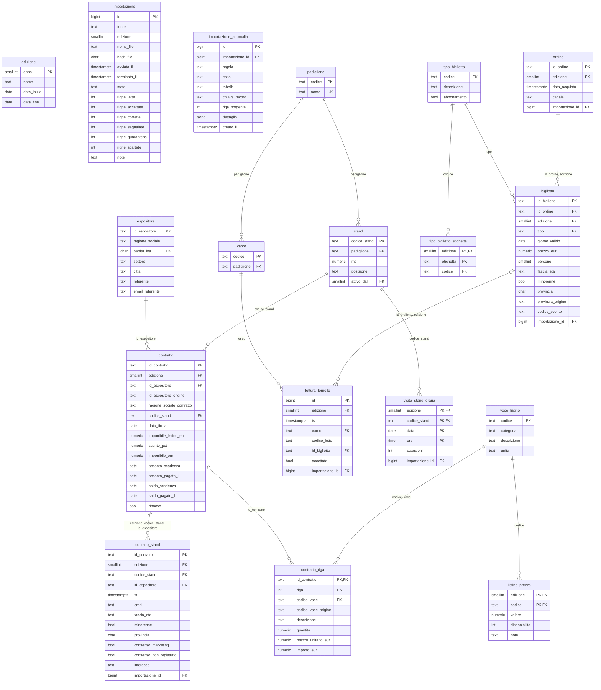

# BID-02 — Modello dati condiviso (proposta BID)

> Stato: proposta del team BID, verificata su dati reali e da concordare con il BAD e con il cliente.

Questo file raccoglie il contenuto del dossier rinominato `BID-02`, integrando le scelte di modellazione, il diagramma ER, il dizionario dati e le verifiche eseguite. È stato aggiornato al 23 ottobre 2026.

---

## 1. Obiettivo e principio guida

Il modello nasce dall’analisi dei file reali ricevuti e non da un’ipotesi astratta. La direzione è stata:

- usare un solo database condiviso (`arcade`);
- tenere separate le due edizioni (`2024` e `2025`), senza mescolare i fatti;
- evitare di inventare dati dove i file non li danno;
- tracciare tutte le anomalie e le righe sospette senza perdere evidenza;
- lasciare un punto di controllo per le regole di qualità e i flag di supporto, senza dover ricaricare tutto in caso di modifica.

Il modello è stato verificato con le migrazioni e con i dati reali, ma resta una proposta BID da confermare con il BAD e con il cliente prima del congelamento del design.

---

## 2. Scelte di modellazione e punti di accordo

| # | Scelta | Motivo | Alternativa scartata |
|---|---|---|---|
| M1 | `edizione.anno` come chiave naturale | È già usato nei file e nel brief | Chiave surrogata inutile |
| M2 | `ordine` e `biglietto` separati, con FK composta `(id_ordine, edizione)` | Un ordine può contenere più biglietti; evita incroci tra edizioni | Tabella unica con dati d’ordine ripetuti |
| M3 | Codici canonici per i tipi di biglietto + tabella di decodifica per edizione | Le etichette cambiano tra 2024 e 2025 | Testo libero e statistiche incoerenti |
| M4 | `lettura_tornello` salva `codice_letto` grezzo e `id_biglietto` nullable | I codici sconosciuti vanno tenuti, non scartati | Scartare le letture respinte |
| M5 | Deduplicazione tramite `UNIQUE (edizione, varco, codice_letto, ts)` | Protegge dal doppio caricamento dello stesso evento | Regola di soglia temporale non approvata |
| M6 | Doppioni ravvicinati e acquisti posteriori come flag nelle viste | Si tratta di comportamento valutativo, non di dato persistente | Scrivere i flag nei fatti |
| M7 | `minorenne` generata da `fascia_eta` | Non può diventare incoerente | Colonna scritta dall’importatore |
| M8 | `visita_stand_oraria` su base oraria `(edizione, stand, data, ora)` | È la granularità del file | Inventare righe a zero |
| M9 | `contatto_stand` collegato a `contratto(edizione, stand, espositore)` | Il contatto non può essere attribuito a un espositore senza lo stand | FK separate non coerenti |
| M10 | Un contratto per stand per edizione | È ciò che risultano dai dati 2024 e 2025 | Molti contratti per lo stesso stand |
| M11 | `contratto.id_espositore_origine` ∈ {`sorgente`, `derivato`} | 2024 non ha ID espositore: derivato dal nome | Nascondere la derivazione |
| M12 | `voce_listino.codice` canonico + `codice_voce_origine` nelle righe | Tracciabilità del valore originale | Sovrascrivere la sorgente |
| M13 | Idempotenza importi tramite indice unico parziale `(fonte, hash_file) WHERE stato='completata'` | Riesecuzione dello stesso file non duplica | Controllo solo applicativo |
| M14 | Viste di supporto per portale e controlli | Un solo punto in cui si nasconde la logica dei minori e dei filtri | Logica ripetuta in più parti |
| M15 | Tolleranza nei CHECK (importi ±0,01 €) | Arrotondamenti nei file sorgente | Uguaglianza totale che genera falsi errori |

## 3. Punti da concordare con il BAD e con il cliente

| # | Domanda | Proposta BID | Impatto sul modello |
|---|---|---|---|
| C1 | Convenzione dell’ID contratto | `C{anno}-{nnnn}` come nei file | CHECK sul contratto |
| C2 | Un solo contratto per stand/edizione? | Sì | UNIQUE del contratto per stand |
| C3 | ID espositore 2024 derivato dal nome | Confermare mapping esterno | `id_espositore_origine` |
| C4 | Preventivi e stati 2026 | Non modellati (non esistono nei dati) | Nuove tabelle/colonne V008+ |
| C5 | Pagamenti vuoti: significato di `NULL` | `NULL` = non registrato | Nullabilità delle colonne |
| C6 | Prezzi storici del listino | `listino_prezzo` per edizione | Una riga per voce ed edizione |
| C7 | Superficie per il ricavo/m² | Superficie dello stand | Nessuna modifica, solo viste/KPI |
| C8 | Consenso marketing dei minori | Mai esposto; consenso vuoto = NO | Colonne `consenso_*` |
| C9 | Soglia dei doppioni e definizione di “presenze” | Soglia 60 s come ipotesi | Solo flag nelle viste |
| C10 | Orario di acquisto alla cassa | Non disponibile | Flag informativo |
| C11 | Uscite ai varchi | Assenti, non calcolabili | Nessuna tabella di uscita |
| C12 | 912 scansioni alle 08:00 | In quarantena finché il cliente non risponde | `importazione_anomalia` |

## 4. Cosa il modello non contiene

Volutamente non sono presenti:

- preventivi e stati contrattuali;
- utenti/credenziali del portale;
- eventi di uscita;
- costi dell’espositore per il costo per contatto;
- dati dimostrativi nelle migrazioni.

Questi elementi verranno aggiunti in migrazioni successive solo dopo accordo formale.

## 5. Limiti noti

- `v_contatto_portale` maschera i dati dei minori ma non filtra per espositore: il filtro va imposto lato server nelle API.
- `v_lettura_valutata` usa una funzione finestra: accettabile per ora ma da ottimizzare se usata spesso.
- L’idempotenza degli importi è garantita a livello di schema; la pipeline è un lavoro separato.

---

## 6. Diagramma ER

---

## 7. Dizionario dati sintetico

### `biglietto`

Un biglietto venduto, non una persona entrata. Un Family vale 4 persone, un abbonamento 3 giorni.

| Colonna | Tipo | Null | Note |
|---|---|---|---|
| `id_biglietto` | text | no | PK |
| `id_ordine` | text | no | FK a `ordine` |
| `edizione` | smallint | no | FK a `edizione` |
| `tipo` | text | no | FK a `tipo_biglietto` |
| `giorno_valido` | date | sì | `NULL` = abbonamento |
| `prezzo_eur` | numeric | no | Prezzo totale del biglietto |
| `persone` | smallint | no | 1 o 4 per Family |
| `fascia_eta` | text | sì | `NULL` = non rilevata |
| `minorenne` | boolean | sì | Calcolato |
| `provincia` | char(2) | sì | Sigla normalizzata |
| `provincia_origine` | text | sì | Valore originale |
| `codice_sconto` | text | sì | |
| `importazione_id` | bigint | no | FK a `importazione` |

### `contratto`

Contratto di uno stand per un’edizione. Uno stand si vende una sola volta per edizione.

| Colonna | Tipo | Null | Note |
|---|---|---|---|
| `id_contratto` | text | no | PK |
| `edizione` | smallint | no | FK a `edizione` |
| `id_espositore` | text | no | FK a `espositore` |
| `id_espositore_origine` | text | no | `sorgente` o `derivato` |
| `ragione_sociale_contratto` | text | no | |
| `codice_stand` | text | no | FK a `stand` |
| `data_firma` | date | no | |
| `imponibile_listino_eur` | numeric | no | |
| `sconto_pct` | numeric | no | Frazione, es. `0,15` |
| `imponibile_eur` | numeric | no | |
| `acconto_scadenza` | date | no | |
| `acconto_pagato_il` | date | sì | `NULL` = non registrato |
| `saldo_scadenza` | date | no | |
| `saldo_pagato_il` | date | sì | `NULL` = non registrato |
| `rinnovo` | boolean | no | |

### `lettura_tornello`

Una lettura a un varco; i dati contengono solo ingressi, non uscite.

| Colonna | Tipo | Null | Note |
|---|---|---|---|
| `id` | bigint | no | PK |
| `edizione` | smallint | no | |
| `ts` | timestamptz | no | |
| `varco` | text | no | |
| `codice_letto` | text | no | Anche se non esiste in biglietteria |
| `id_biglietto` | text | sì | NULL se non risolto |
| `accettata` | boolean | no | `true` = OK/1 |
| `importazione_id` | bigint | no | FK a `importazione` |

### `visita_stand_oraria`

Aggregato orario delle visite allo stand per edizione.

| Colonna | Tipo | Null | Note |
|---|---|---|---|
| `edizione` | smallint | no | PK |
| `codice_stand` | text | no | PK |
| `data` | date | no | PK |
| `ora` | time | no | PK |
| `scansioni` | int | no | Conteggio orario |
| `importazione_id` | bigint | no | FK |

---

## 8. Verifiche eseguite

Ambiente: PostgreSQL 16 locale temporaneo, non il database di team.

| Verifica | Come | Esito |
|---|---|---|
| Migrazioni V001–V007 applicate da zero | `db/applica.sh` | ✔ nessun errore |
| Vincoli, trigger e viste | `db/tests/test_vincoli.sql` | ✔ 78/78 casi passati |
| Adattamento ai dati reali | `db/tests/prova_adattamento_dati_reali.py` | ✔ 52/52 conteggi coincidenti |
| Prestazioni essenziali | `EXPLAIN ANALYZE` su query tipiche | ✔ tempi compatibili |

### Volumi caricati nella prova

- biglietto: 78.275
- lettura_tornello: 102.816
- ordine: 47.000
- visita_stand_oraria: 2.450
- contatto_stand: 1.707
- contratto: 198
- contratto_riga: 950
- importazione_anomalia: 1

### Tempi di esecuzione

| Query | Tempo | Nota |
|---|---|---|
| Ingressi per ora e padiglione 2025 | 42 ms | aggregazione completa |
| Visite di un espositore | 0,16 ms | indice PK |
| Ingressi di un biglietto | 0,07 ms | indice parziale |
| `v_lettura_valutata` 2025 | 292 ms | candidata a ottimizzazione |
| Biglietti per giorno e tipo | 13,8 ms | |
| Contatti di uno stand | 0,08 ms | |

## 9. Cosa non è stato verificato

- nessuna pipeline di importazione reale;
- nessuna API o interfaccia; 
- nessuna prova su database condiviso/concorrenza;
- nessuna verifica con la struttura dati del BAD/Power Platform;
- le performance sono indicative e non su carico reale.

---

## 10. Stato finale di BID-02

Il dossier BID-02 rappresenta il modello dati condiviso più maturo prodotto finora: ha una base strutturale coerente, è verificato sui dati reali e permette di continuare con la progettazione di ETL, API e dashboard. Il passo successivo è la condivisione con il BAD e il congelamento formale delle scelte prima del SAL 1.
