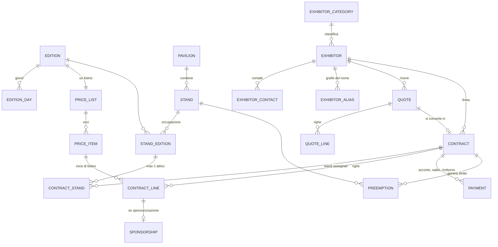
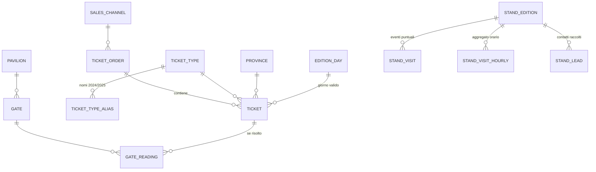

# Modello dati — schema del database V1…V8

> Collegamenti: [[00-indice]] · [[contesto-BID]] · [[contesto-BAD]] · [[kpi]] · [[anomalie-dati]] · [[glossario]]

Aggiornato: 11 novembre 2026. Spiega com'è fatto il database e cosa aggiunge ogni migrazione.
Il codice SQL **non sta nel vault**: V1–V5 sono nel ramo `BID` in `database/migrations/`, V6–V8 sono del BAD e vanno portate lì con una PR. La progettazione completa è in `docs/data-model.md` del ramo `BID`.
Il database ufficiale è PostgreSQL 16 su Azure (B-17), condiviso da BAD e BID.

## Le cinque "stanze"
| Schema | A cosa serve | Contenuto |
|---|---|---|
| `staging` | copia dei file del cliente **così come arrivano**, tutto testo | 10 tabelle `stg_*` |
| `core` | i dati veri, ordinati e protetti da vincoli | 42 tabelle |
| `dq` | qualità dei dati: batch, regole, anomalie, quarantena, riconciliazioni | 6 tabelle + viste di controllo |
| `analytics` | dimensioni, fatti e KPI per Power BI e API | solo viste e una funzione |
| `portal` | le sole viste che un espositore può leggere | 4 viste |

Flusso: `file → staging → controlli (dq) → core → analytics / portal → Power Apps, Power BI, API, portale`. I record dubbi finiscono in `dq.quarantine`, i problemi in `dq.anomaly`: niente si scarta in silenzio.

## Tre idee da ricordare
1. **Stand ≠ occupazione**: `stand` è il posto fisico, `stand_edition` dice com'è occupato in un'edizione.
2. **Espositore ≠ contratto**: l'azienda è una (`exhibitor`), i contratti sono uno per edizione (`contract`).
3. **Le regole stanno nel DB**: la doppia vendita è impossibile per vincolo (`ux_contract_stand_active`), anche se due persone salvano nello stesso istante.

## Commerciale (le tabelle che usa Power Apps)

## Biglietteria, varchi, visite e contatti

## Tabelle di `core` per area
| Area | Tabelle |
|---|---|
| Edizioni e spazi | `edition`, `edition_day`, `pavilion`, `stand`, `stand_edition` |
| Espositori | `exhibitor`, `exhibitor_category`, `exhibitor_contact`, `exhibitor_alias` |
| Listino | `price_list`, `price_item` |
| Vendita | `quote`, `quote_line`, `contract`, `contract_stand`, `contract_line`, `sponsorship`, `payment`, `preemption` |
| Biglietteria | `ticket_order`, `ticket`, `ticket_type`, `ticket_type_alias`, `sales_channel`, `discount_code`, `age_band`, `province`, `province_alias` |
| Varchi | `gate`, `gate_alias`, `gate_reading`, `device` |
| Stand in fiera | `stand_visit`, `stand_visit_hourly`, `stand_lead`, `lead_interest` |
| Utenti e audit | `app_user`, `app_role`, `user_role`, `audit_log` |
| Sorgenti | `data_source`, `external_id_map` |

## Cosa aggiunge ogni migrazione
| File | Di chi | Cosa crea o cambia | Stato |
|---|---|---|---|
| **V1** `core_schema` | BID | Schemi `staging`, `core`, `dq`: 58 tabelle, vincoli (doppia vendita, importi coerenti, giorno valido nell'edizione), indici e 3 viste di controllo (`v_contract_amount_mismatch`, `v_payment_status`, `v_stand_status_mismatch`) | sul server |
| **V2** `reference_data` | BID | Solo dati: sorgenti con fuso orario, edizioni 2024/25/26 con i giorni, padiglioni, varchi, canali, tipi biglietto con i nomi dei due anni, province con le varie grafie, ruoli, regole di qualità e controlli di riconciliazione | sul server (alias Business Day corretto l'8/11) |
| **V3** `roles_grants_rls` | BID | Ruoli di gruppo `arcade_app`, `arcade_portal`, `arcade_etl`, `arcade_bi`; permessi; RLS (`staff_all` per staff ed ETL, `portal_own` in sola lettura per l'espositore); funzione `core.current_exhibitor_id()`. Gli utenti di login si creano a parte, per ambiente | sul server |
| **V4** `analytics` | BID | Schemi `analytics` (9 dimensioni, 7 fatti, 11 viste KPI, 2 di riconciliazione, funzione `presence_estimate()`) e `portal` (`v_my_contracts`, `v_my_visits_hourly`, `v_my_kpi`, `v_benchmark_visits_per_sqm`) | sul server |
| **V5** `ingest_ticketing_turnstiles_stand_visits` | BID | Funzioni di pulizia (`dq.try_date`, `try_time`, `try_numeric`, `try_timestamptz`, `norm_text`…), `dq.add_anomaly`, procedure `dq.load_ticket_batch`, `load_gate_batch`, `load_stand_visit_batch`, `finish_batch`, vista `dq.v_import_quality_report`. Nessuna tabella nuova | sul server, versione del 4/11 |
| **V6** `ingest_commercial` | BAD | Caricatore dell'Excel commerciale: solo funzioni e procedure, stesso modello staging → dq → core della V5. Nessuna tabella nuova (B-32) | sul server, **da portare nel repo** |
| **V7** `ingest_stand_leads` | BAD | Caricatore dei contatti stand: email solo come hash con sale, email in chiaro cancellata dallo staging, minori in `PRIVACY_REVIEW`. Nessuna tabella nuova (B-34) | sul server, **da portare nel repo** |
| **V8** `power_apps_identity` | BAD | Chiavi di 8 tabelle (`quote`, `quote_line`, `contract`, `contract_stand`, `contract_line`, `payment`, `sponsorship`, `gate_reading`) da `GENERATED ALWAYS` a `BY DEFAULT`, più un trigger che assegna il numero quando arriva 0. Serve perché il connettore di Power Apps vuole sempre la chiave. Nessuna tabella, colonna o dato nuovo; i test del BID danno lo stesso risultato (B-38) | sul server, **da portare nel repo** |

## Ruoli e accessi
| Ruolo | Chi | Può fare |
|---|---|---|
| `arcade_app` | Power Apps e backend (staff) | legge e scrive `core`; audit solo in aggiunta |
| `arcade_portal` | backend per un espositore | sola lettura, solo le proprie righe (RLS, fail-closed) |
| `arcade_etl` | caricamenti | scrive `staging` e `core`, non cancella dal `core` |
| `arcade_bi` | Power BI | solo lo schema `analytics` |

I ruoli applicativi delle app (`ADMIN`, `COMMERCIAL`, `OPS`, `EXHIBITOR`, `SCANNER`, `BI_READER`, più `DIRECTION` aggiunto dal BAD, B-36) sono righe di `core.app_role`, assegnate in `core.user_role`.

## Regole pratiche per chi scrive dalle app
- Nei `Patch` di creazione la chiave si passa **sempre a 0**, e vanno passate tutte le colonne NOT NULL, anche quelle con default (B-38).
- `quote_number` e `contract_number` li genera l'app: `PV2026-0001`, `C2026-0001` (B-37).
- Su una riga di `dq.anomaly` o `dq.quarantine` non si cancella niente: si cambia lo stato di risoluzione.
