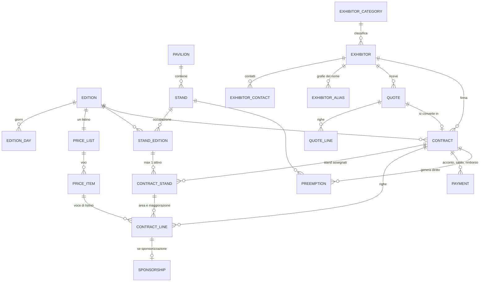
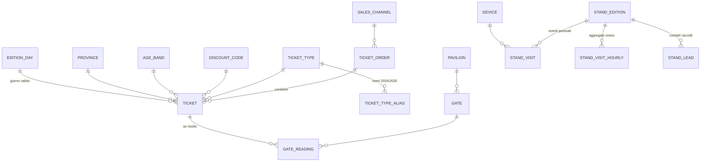
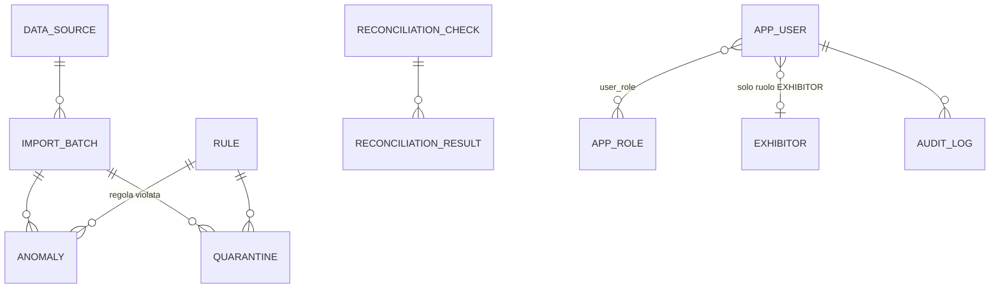

# ARCADE Milano — Progettazione del modello dati PostgreSQL

Versione: bozza 1 · 23 ottobre 2026 · Autore: area BID (database) · Stato: **da condividere con il BAD per il congelamento del 30/10**

Artefatti collegati:
- [database/migrations/V1__core_schema.sql](../database/migrations/V1__core_schema.sql) — schemi `core`, `staging`, `dq` (58 tabelle, 3 viste di controllo)
- [database/migrations/V2__reference_data.sql](../database/migrations/V2__reference_data.sql) — dati di riferimento (lookup), regole DQ, controlli di riconciliazione
- [database/migrations/V3__roles_grants_rls.sql](../database/migrations/V3__roles_grants_rls.sql) — ruoli, grant, Row Level Security per il portale espositori
- [database/migrations/V4__analytics.sql](../database/migrations/V4__analytics.sql) — schemi `analytics` (stella + KPI) e `portal` (viste per gli espositori)

> **Stato reale**: V1–V4 sono stati eseguiti in sequenza su PostgreSQL 16 (Docker `postgres:16-alpine`) senza errori, e sono stati eseguiti test su vincoli, KPI, RLS e permessi con **dati sintetici scritti per il test** (§9). Nessun dato del cliente è ancora stato caricato: l'ETL **non esiste ancora**. Le cifre del §2 derivano da un profiling dei file ricevuti, non da un caricamento. I valori dei KPI su dati reali sono quindi **sconosciuti**.

---

## 1. Principi di progetto

1. **Tre schemi, tre responsabilità.** `staging` = copia grezza dei file (tutto `text`, nessun vincolo di dominio, così nessuna riga viene persa in lettura); `core` = modello normalizzato e vincolato; `dq` = batch, regole, anomalie, quarantena, riconciliazioni. Gli schemi `analytics` (stella e KPI) e `portal` (viste per gli espositori) sono costruiti sopra (V4).
2. **Identità ≠ occupazione ≠ contratto.** `stand` (fisico, stabile) è distinto da `stand_edition` (occupazione in una edizione); `exhibitor` (azienda) è distinto da `contract` (rapporto in una edizione).
3. **I vincoli stanno nel database**, non solo nel backend: la doppia vendita di uno stand è impossibile anche se due richieste arrivano insieme o se qualcuno scrive via SQL.
4. **Niente dato derivato memorizzato** quando può essere calcolato (stato espositore, stato pagamento, saturazione). Dove memorizziamo un valore *assunto* lo marchiamo (`paid_amount_is_assumed`, `due_amount_basis`, `origin`).
5. **Nessuno scarto silenzioso.** Una riga problematica va in `dq.anomaly` e, se serve, in `dq.quarantine` con la riga originale in `jsonb`.
6. **Provenienza ovunque**: ogni fatto porta `source_id` e `import_batch_id`.
7. **Privacy by design**: l'email dei contatti stand non entra mai nel `core` (solo hash); i contatti degli espositori sono in tabella separata; i visitatori non hanno anagrafica.

---

## 2. Cosa c'è nei file del cliente (profiling reale)

### 2.1 Inventario

| File | Righe dati | Formato | Note |
|---|---:|---|---|
| `ARCADE_Commerciale.xlsx` · Espositori | 135 | Excel | id, P.IVA, settore, città, referente, email |
| · Planimetria | 130 | Excel | 3 padiglioni; 115 stand attivi dal 2024, 15 dal 2025 (P3-C01…C15) |
| · Listino_2026 | 20 | Excel | area €/m² per padiglione, maggiorazioni %, 6 sponsorizzazioni con disponibilità, 6 extra, condizioni |
| · Contratti | 198 | Excel | 88 del 2024 + 110 del 2025 |
| · Righe_contratto | 950 | Excel | area, maggiorazioni, extra, sponsorizzazioni |
| `biglietteria_2024.csv` | 35.719 | `;` · date `dd/mm/yyyy hh:mm` · decimali con virgola | |
| `biglietteria_2025.csv` | 42.556 | stesso tracciato | nomi dei tipi diversi dal 2024 |
| `tornelli_2024.csv` | 46.824 | `;` · `data;ora;varco;codice;esito` · **ora locale, senza fuso** | esito `1/0` |
| `tornelli_2025.csv` | 55.992 | `,` · `timestamp_utc,ticket_code,gate_id,result` · **UTC (suffisso Z)** | esito `OK/KO` |
| `contatti_stand_2025.csv` | 1.707 | `,` | **contiene email e consenso marketing** |
| `visite_stand_2025.csv` | 2.451 | `,` · `codice_stand,data,ora,scansioni` | **aggregato per ora**, solo 2025 |

Il file `~$ARCADE_Commerciale.xlsx` nello zip è un lock-file temporaneo di Excel (da ignorare). `.DS_Store` idem.

### 2.2 Fatti che orientano lo schema

| # | Osservazione | Conseguenza di progetto |
|---|---|---|
| O1 | Le date Excel sono **numeri seriali** (epoca 1899-12-30). | Lo staging le conserva come testo; la trasformazione fa `DATE '1899-12-30' + n`. |
| O2 | 2024 e 2025 hanno **tracciati, separatori, fusi e codifiche diverse** (tornelli, tipi biglietto). | Staging separato per layout (`stg_gate_reading_v1/v2`); `data_source.source_timezone`; tabella di alias dei tipi. |
| O3 | I tornelli 2025 sono in UTC: `08:00:05Z` = 09:00:05 ora di Milano, coerente con l'apertura 09:00 del 2024. | Conferma l'ipotesi UTC→Europe/Rome; tutto in `timestamptz`. |
| O4 | I tornelli **non hanno direzione** (solo ingressi) e i varchi sono per padiglione (`P1 Nord`, `P1 Sud`, `P2 Ovest`, `P3 Est`). | Un passaggio è un **ingresso in un padiglione**, non l'ingresso all'evento. Nessuna uscita ⇒ le presenze possono essere solo **stimate**. `gate.direction_mode`, `gate_reading.direction`. |
| O5 | Un biglietto passa più volte ai tornelli (6.709 codici nel 2024, 8.124 nel 2025, fino a 7 passaggi): abbonamento 3 giorni + più padiglioni. | “Passaggi totali” ≠ “ingressi unici” ≠ “biglietti validati”. |
| O6 | 35 codici tornello (2024) e 35 (2025) **non esistono in biglietteria**; 1.272 (2024) e 1.515 (2025) biglietti non hanno mai passato un varco. | `gate_reading.ticket_code` grezzo + `ticket_id` nullable; anomalia GAT-001. I biglietti mai scansionati sono il dato “venduti vs validati”, non un errore. |
| O7 | `Persone = 4` per i biglietti Family (2.420 nel 2024, 2.901 nel 2025): **un biglietto, quattro persone**. | `ticket.persons`. I KPI sui visitatori devono dichiarare se contano biglietti o persone. |
| O8 | `Giorno valido` è una data **oppure** il testo `3 giorni` (abbonamento). | `valid_day` nullable + `ticket_type.is_multi_day`; FK composita verso `edition_day`. |
| O9 | `Provincia` è vuota in 2.158 biglietti (2024) e 2.525 (2025), e grafie multiple (`MI`, `MILANO`, `Milano`, `Monza e Brianza`, `MONZA E BRIANZA`…): 21 province reali. | `province` + `province_alias` normalizzato in maiuscolo; vuoto ⇒ `NULL` (info, non errore). |
| O10 | `Fascia eta titolare` contiene anche il valore **`famiglia`**, che non è una fascia d'età. | `age_band.kind` = `AGE` o `FAMILY`. |
| O11 | I prezzi biglietto hanno una seconda tariffa pari a **−10 %** (20→18, 55→49,50…) legata ai codici sconto. | `discount_code.observed_pct`, da confermare. |
| O12 | **Contratti 2024: `id_espositore` e `partita_iva` vuoti**; solo ragione sociale con grafie sporche (`Bussola Gears.`, `ZENIT STUDIOS S.P.A.`). Dopo normalizzazione 79 nomi su 88 coincidono con l'anagrafica; **9 no** (Ardesia Markets, Bussola Gears, Delta Workshops, Dora Techs, Idra Entertainments, Isola Snacks, Pietra Entertainments, Pixelia Pixels, Tundra Distribuzioni). | `exhibitor_alias` con metodo di match e conferma umana; i 9 vanno in quarantena (COM-002) finché non risolti. |
| O13 | Il listino fornito è **solo il 2026**. Nei contratti il prezzo €/m² è: 2024 = 110/150/165, 2025 = 120/160/180, 2026 = 125/170/190. Extra costanti 2024-2026 (EL3 250, EL6 420, FIBRA 600, ARR 25, PASS 20, PARK 60); sponsorizzazioni 2024 = 90 % di quelle 2025-26. | Un listino per edizione (`price_list.edition_id UNIQUE`); 2024/2025 **ricostruiti dalle righe** (`origin = RECONSTRUCTED_FROM_CONTRACTS`), da far validare. Mappatura prezzo→padiglione assunta (P3 < P2 < P1, coerente col 2026). |
| O14 | Le **sponsorizzazioni sono righe contratto** (`SP-*`), non entità autonome. 2025: 10 `SP-SOCIAL` (disponibilità 10), 3 `SP-TORNEO` (disp. 3). | `contract_line.line_type = SPONSORSHIP` + `sponsorship` come estensione di esecuzione: il valore economico è in una sola tabella (no doppio conteggio). |
| O15 | Le **maggiorazioni** (`MAGG`, 74 righe) sono righe con importo = % × area dello stand. | `line_type = SURCHARGE`, legata allo stesso `contract_stand`. |
| O16 | `imponibile_eur = imponibile_listino_eur × (1 − sconto)` in **tutti** i 198 contratti, e la somma delle righe = imponibile di listino in tutti i 198. | `CHECK` sul contratto; vista di controllo `dq.v_contract_amount_mismatch`. |
| O17 | Il contratto dà **solo le date** di acconto/saldo (scadenza e pagamento), non gli importi. Acconto 30 % alla firma e saldo 30 giorni prima dell'apertura (Listino): il saldo cade il 20/11/2024 e 19/11/2025, cioè 30 giorni prima. | `payment` con `due_amount` derivato dalla regola (`RULE_DERIVED`) e `paid_amount_is_assumed`. |
| O18 | 8 acconti e 8 saldi senza data di pagamento; 121 acconti e 119 saldi pagati **dopo** la scadenza. | Stato pagamento derivato in `dq.v_payment_status`; anomalie COM-006/COM-010. |
| O19 | `rinnovo = 1` in 70 contratti 2025 (0 nel 2024): 64 su 70 hanno un contratto 2024 con lo stesso nome; **6 no**. | `contract.is_renewal` con semantica da confermare; regola COM-009. |
| O20 | Nei dati 2025 ogni contratto ha un espositore distinto (110/110); 25 espositori in anagrafica non compaiono nei contratti 2025 (alcuni potrebbero aver esposto solo nel 2024: i contratti 2024 non hanno id). | `UNIQUE(edition_id, exhibitor_id)` **non imposto** (decisione D-07); lo stato prospect/attivo si deriva dai contratti. |
| O21 | `contatti_stand_2025`: 1.707 contatti, **tutti** con `consenso_marketing = SI`; **14 sono 14-17 anni** con consenso; 19 email ripetute; 9 senza interesse; **email in chiaro**. | Hash al posto dell'email, `review_status = PRIVACY_REVIEW`, regole LED-001…LED-006. |
| O22 | `visite_stand_2025`: 84 stand, 3 giorni, orari 09:00–18:00 più **una riga alle 08:00 con 912 scansioni** (P1-A02, 19/12), mentre il massimo altrove è 177. | `stand_visit_hourly` (non si inventano eventi puntuali); outlier VIS-001. |
| O23 | I contatti sono 84 stand su 110 contratti 2025: 26 contratti senza contatti e 26 stand senza visite. | Non è un errore: il KPI “visite per stand” deve gestire i NULL. |
| O24 | Il brief dice “fine novembre”; i dati dicono **19-22 dicembre**. | Domanda Q-01. `edition_day` è popolata dai dati. |

---

## 3. Modello logico

### 3.1 Commerciale

### 3.2 Biglietteria, accessi, visite

### 3.3 Qualità, provenienza, sicurezza

---

## 4. Tabelle e scelte principali

### 4.1 Schema `core` — scopo, chiavi, unicità

| Tabella | Scopo | PK · business key · unicità rilevanti |
|---|---|---|
| `data_source` | Sorgente con fuso orario e flag demo | `source_id` · `code` |
| `edition`, `edition_day` | Edizioni e giorni di apertura | `year` UNIQUE · PK `(edition_id, day_date)` |
| `pavilion`, `stand` | Struttura fisica stabile | `stand_code` UNIQUE (`P1-A01`), formato validato da regex |
| `stand_edition` | Stand in una edizione, con stato commerciale | UNIQUE `(stand_id, edition_id)` · `row_version` per lock ottimistico |
| `exhibitor` (+ `_category`, `_contact`, `_alias`) | Identità azienda | `exhibitor_code` (ESP001) e `vat_number` UNIQUE · alias UNIQUE per nome normalizzato |
| `price_list`, `price_item` | Listino per edizione, con condizioni (acconto, saldo, prelazione) | UNIQUE `edition_id` · `(price_list_id, code)` · un solo `SPACE` per padiglione e un solo `SURCHARGE` per posizione (indici parziali) |
| `quote`, `quote_line` | Preventivo | `quote_number` UNIQUE |
| `contract`, `contract_line` | Contratto firmato e righe | `contract_number` UNIQUE · `quote_id` UNIQUE (1 preventivo → max 1 contratto) |
| `contract_stand` | **Assegnazione stand↔contratto** | indice parziale `UNIQUE(stand_edition_id) WHERE released_at IS NULL` |
| `sponsorship` | Esecuzione sponsorizzazione | `contract_line_id` UNIQUE |
| `payment` | Acconto/saldo/rimborso | UNIQUE parziale `(contract_id, kind)` per DEPOSIT/BALANCE |
| `preemption` | Diritto di prelazione | UNIQUE parziale `(stand_id, for_edition_id)` sui diritti vivi |
| `sales_channel`, `ticket_type` (+alias), `discount_code`, `age_band`, `province` (+alias) | Lookup normalizzati | alias come PK testuale |
| `ticket_order`, `ticket` | Ordine e biglietto | `order_code`, `ticket_code` UNIQUE |
| `gate` (+alias), `device`, `gate_reading` | Varchi e letture | UNIQUE `(source_id, source_row_key)` |
| `stand_visit`, `stand_visit_hourly` | Visite puntuali (app) e aggregate orarie (legacy 2025) | `visit_uuid` UNIQUE · PK `(stand_edition_id, visit_date, visit_hour)` |
| `stand_lead`, `lead_interest` | Contatti raccolti (senza email in chiaro) | `lead_code` UNIQUE |
| `app_user`, `app_role`, `user_role`, `audit_log` | Accessi e audit | `exhibitor_id` sull'utente = chiave di isolamento |
| `external_id_map` | Riconciliazione ID esterni | PK `(source, tipo, id_esterno)` |

### 4.2 Come si impediscono errori e duplicazioni

| Rischio | Meccanismo (nel database) |
|---|---|
| Stand venduto a due espositori nella stessa edizione | indice parziale `ux_contract_stand_active` — verificato col test 1 |
| Assegnare lo stand di un'altra edizione a un contratto | FK **composite** `(stand_edition_id, edition_id)` e `(contract_id, edition_id)` in `contract_stand` — test 2 |
| Imponibile non coerente con sconto, righe non coerenti con qta × prezzo | `CHECK` con tolleranza 0,01 € — test 3 |
| Giorno valido fuori dall'edizione | FK composita `(edition_id, valid_day)` → `edition_day` — test 4 |
| Re-import dello stesso file | `UNIQUE(source_id, file_sha256)` sul batch · `UNIQUE(source_id, source_row_key)` sulle letture · `ux_anomaly_idempotent` — test 6 |
| Righe di sponsorizzazione contate due volte | il valore sta solo in `contract_line`; `sponsorship` non ha importi |
| Acconti sommati ai ricavi | `payment` separato da `contract.net_amount`, con commento esplicito |
| Stand `SOLD` senza contratto attivo (o viceversa) | `dq.v_stand_status_mismatch` — test 7 |
| Somma righe ≠ importo contratto | `dq.v_contract_amount_mismatch` — test 8 |
| Duplicati non banali di espositori | `vat_number` UNIQUE + `exhibitor_alias.alias_norm` UNIQUE + indice trigram per proporre match |

### 4.3 Indici motivati

| Indice | Perché |
|---|---|
| `ux_contract_stand_active`, `ux_payment_one_deposit_balance`, `ux_preemption_live_per_stand`, `ux_exhibitor_one_primary_contact` | Regole di business come vincolo (indici **parziali**) |
| `ix_gate_reading_gate_time (gate_id, read_at)` | Presenze per padiglione/varco in finestra temporale |
| `ix_gate_reading_ticket (ticket_id, read_at) WHERE ticket_id IS NOT NULL` | Passaggi per biglietto, senza indicizzare gli orfani |
| `ix_gate_reading_time_brin` · `ix_audit_log_time` (BRIN) | Tabelle append-only ordinate per tempo: indice minuscolo |
| `ix_stand_visit_stand_time` | Visite per stand nel tempo |
| `ix_stand_edition_edition_status` | Saturazione e disponibilità per edizione |
| `ix_payment_open_due` (parziale) | Promemoria scadenze: solo pagamenti ancora aperti |
| `ix_anomaly_open` (parziale) | Pagina qualità dati: solo anomalie aperte |
| `ix_exhibitor_name_trgm` (GIN) | Proposta di match fuzzy per i 9 nomi 2024 non risolti |

**Partizionamento**: non previsto. Il volume è ~50-60 mila letture per edizione (anche a 50.000 visitatori reali, poche centinaia di migliaia): un indice BRIN + btree basta. Si rivaluta oltre i ~50 milioni di righe.

---

## 5. Identificativi e riconciliazione

| Entità | Chiave stabile interna | Chiave di business | Riconciliazione |
|---|---|---|---|
| Espositore | `exhibitor_id` | `exhibitor_code` (ESP001) + `vat_number` | 2025: diretta. 2024: per nome → `exhibitor_alias` (EXACT → NORMALIZED → FUZZY con conferma umana) |
| Stand | `stand_id` | `stand_code` | diretta in tutti i file |
| Contratto | `contract_id` | `contract_number` | diretta |
| Biglietto | `ticket_id` | `ticket_code` (T24…, T25…) | il prefisso anno evita collisioni tra edizioni |
| Lettura varco | `reading_id` | `(source_id, source_row_key)` con chiave = `varco|codice|timestamp originale` | idempotenza |
| Contatto | `lead_id` | `lead_code` (L2500001) | |

I tipi biglietto (8 canonici, 16 alias) e i varchi (4 canonici, 8 alias) si normalizzano con tabelle di alias, non con `CASE` nel codice ETL: sono dati, e si estendono senza deploy.

**Fusi orari.** 2024 locale → `AT TIME ZONE source_timezone`; 2025 già UTC. Tutto si salva in `timestamptz`. Il “giorno” per KPI e report si calcola in `Europe/Rome` (le 23:30 UTC non cadono nel giorno sbagliato).

---

## 6. Ordine di caricamento ETL (dipendenze)

1. `stg_*` ← file (un batch per file, hash SHA-256)
2. Lookup già seminati da V2 (sorgenti, edizioni, padiglioni, varchi, tipi, province, regole)
3. `exhibitor_category` → `exhibitor` → `exhibitor_contact`
4. `stand` → `stand_edition` (una riga per stand attivo in ogni edizione)
5. `price_list` 2026 dal Listino; 2024/2025 **ricostruiti** dalle righe contratto → `price_item`
6. `exhibitor_alias` (2024) → `contract` → `contract_stand` → `contract_line` → `sponsorship` → `payment`
7. `ticket_order` → `ticket`
8. `gate_reading` (risoluzione `ticket_id`), `stand_visit_hourly`, `stand_lead` (hash)
9. Controlli di riconciliazione → `dq.reconciliation_result`
10. Svuotamento colonne PII dello staging

Ogni passo è idempotente e produce righe in `dq.anomaly` / `dq.quarantine`; il batch si chiude con `rows_read = rows_loaded + rows_quarantined + rows_rejected` (regola GEN-001).

---

## 7. Catalogo anomalie attese (dal profiling)

| Regola | Sorgente | Osservato nel profiling | Gravità · azione prevista |
|---|---|---|---|
| COM-001 | Contratti 2024 | 88 contratti senza id/P.IVA | WARNING · caricato e segnalato |
| COM-002 | Contratti 2024 | 9 ragioni sociali non risolte | ERROR · quarantena |
| COM-006 | Contratti | 8 acconti e 8 saldi senza pagamento | WARNING · caricato e segnalato |
| COM-007 | Contratti | importi pagati non forniti (tutti) | INFO · assunto = dovuto, marcato |
| COM-009 | Contratti 2025 | 6 rinnovi senza contratto 2024 apparente | WARNING |
| COM-010 | Contratti | 121 acconti / 119 saldi pagati in ritardo | INFO (non è un errore dati) |
| TKT-002/003 | Biglietteria | decine di grafie provincia; 4.683 vuote | INFO · normalizzato / `NULL` |
| TKT-007 | Biglietteria | prezzi −10 % (EARLY10 ecc.) | INFO |
| GAT-001 | Tornelli | 35 + 35 codici inesistenti | WARNING · caricato con `ticket_id NULL` |
| GAT-003 | Tornelli | 230 (2024) + 256 (2025) esiti KO | INFO · caricato con `result = KO` |
| GAT-007 | Tornelli 2024 | tutte le righe (ora locale → UTC) | INFO · normalizzato |
| VIS-001 | Visite 2025 | 1 outlier da 912 scansioni (08:00) | WARNING · caricato e segnalato |
| LED-001 | Contatti | 19 email ripetute | WARNING |
| LED-002 | Contatti | 14 contatti 14-17 anni con consenso | **CRITICAL · quarantena** in attesa del referente privacy |
| LED-003 | Contatti | 100 % consenso “SI” | WARNING |
| LED-004 | Contatti | 1.707 email ridotte a hash | INFO |
| LED-006 | Contatti | 9 senza interesse | INFO |

Le regole **GAT-002, GAT-004, GAT-005, GAT-006, TKT-001/004/005/006/008, COM-003/004/005/008, VIS-002/003/004** sono definite ma **non hanno ancora una misura**: si valuteranno solo con l'ETL. Non vanno lette come “zero anomalie”.

---

## 8. Modello analitico e KPI (V4: schemi `analytics` e `portal`)

Regola: **ogni KPI è definito una sola volta, in una vista SQL**. API, portale e Power BI leggono le stesse viste; Power BI non ricalcola le formule (le misure DAX aggregano colonne già corrette).

### 8.1 Dimensioni e fatti

| Oggetto | Granularità | Note anti-doppio-conteggio |
|---|---|---|
| `dim_edition`, `dim_date`, `dim_hour`, `dim_pavilion`, `dim_stand`, `dim_stand_edition`, `dim_exhibitor`, `dim_ticket_type`, `dim_channel` | — | `dim_stand` = stand fisico; l'occupazione è `dim_stand_edition`. `dim_exhibitor` senza dati di contatto |
| `fact_contract_line` | 1 riga contratto (solo contratti SIGNED) | Il ricavo si somma **solo qui**. Lo sconto del contratto è ripartito pro-quota sulle righe (`net_amount_allocated`, non arrotondato): la somma delle righe = `contract.net_amount` esatto |
| `fact_payment` | 1 pagamento | `cash_amount` (rimborsi negativi). Mai sommato al contrattualizzato |
| `fact_ticket` | 1 biglietto | venduti = `COUNT(*)`, persone = `SUM(persons)`; `is_validated` = almeno un passaggio OK |
| `fact_gate_reading` | 1 lettura al varco, con giorno/ora **locali** | `is_first_ok_of_day` / `_pav`: primo passaggio OK di un biglietto **risolto**. Gli orfani non sono ingressi unici |
| `fact_stand_visits` | stand × giorno × ora | Una sola sorgente per cella: se l'app ha eventi puntuali vincono, altrimenti l'aggregato orario (`origin`). Visite ≠ contatti |
| `fact_stand_lead` | 1 contatto | Senza email né hash. “Qualificato” solo se `is_qualified` |
| `fact_presence_estimate` | padiglione × bucket 15′ | **Stima**, vedi §8.3 |

### 8.2 KPI (viste `analytics.kpi_*`)

| Vista | Misure | Definizione adottata (da validare) |
|---|---|---|
| `kpi_visitors_edition`, `kpi_visitors_daily` | `tickets_sold`, `persons_sold`, `tickets_validated`, `validation_rate_pct`, `unique_daily_entries`, `passes_total`, `passes_orphan` | **Non si sommano.** Venduti ≠ validati ≠ passaggi ≠ ingressi-giorno. `unique_daily_entries`: biglietti distinti entrati, per giorno (un abbonamento 3 giorni può valere 3). I visitatori unici (persone) **non sono calcolabili**: nei dati non c'è un identificativo di persona |
| `kpi_presence_peak` + `presence_estimate()` | picco per giorno e padiglione (`pavilion_id NULL` = totale evento) | **Stima**, `is_estimate = true` |
| `kpi_saturation` | `sqm_sellable`, `sqm_sold`, `saturation_pct`, `occupancy_pct` | saturazione = m² venduti / m² commercializzabili × 100. Venduto = assegnazione attiva a contratto SIGNED. Commercializzabile = tutto tranne `NOT_SELLABLE`. `occupancy_pct` include anche gli stand `FREE` (gratuiti). Riservati non venduti sono a parte |
| `kpi_commercial_edition` | `contracted_net`, `space_net`, `extras_net`, `sponsorship_net`, `parts_diff`, `cash_collected`, `revenue_per_sqm`, `deposit_paid_pct`, `quote_conversion_pct` | Ricavo = contrattualizzato **netto sconto, IVA esclusa**. Ricavo/m² = (SPACE + SURCHARGE) / m² venduti; extra e sponsorizzazioni **esclusi** dal numeratore e riportati a parte. `parts_diff` deve essere 0. Incassato = misura separata |
| `kpi_space_revenue_pavilion` | ricavo spazio e €/m² per padiglione | solo righe legate a uno stand |
| `kpi_exhibitor_edition` | ricavo, m², €/m², visite, visite/m², contatti raccolti/qualificati, variazioni vs edizione precedente | `cost_per_qualified_contact` è **NULL per costruzione**: costi attribuibili e definizione di “qualificato” non esistono nei dati (Q-11). Indicatore sostitutivo con nome esplicito: `contract_value_per_visit` |
| `kpi_edition_comparison` | confronto 2024/2025/2026 | variazioni NULL se l'edizione non ha dati (niente falsi −100 %) |
| `kpi_renewal_edition` | tasso di rinnovo | NULL se l'edizione successiva non ha ancora contratti |
| `kpi_data_quality_batch`, `kpi_data_quality_anomaly` | record caricati/scartati/in quarantena, anomalie per fonte e regola | alimentano la pagina 5 di Power BI |
| `reconciliation_current` / `reconciliation_status` | REC-02, 03, 04, 05, 07 | stesso fenomeno, stesso numero tra tabelle core e KPI |

Non coperti da una vista (ancora): REC-01 (righe file vs staging) e REC-06 (visite file vs core) richiedono l'ETL; i KPI direzionali “opportunità di rinnovo” e “prelazioni in scadenza” sono query applicative sulle tabelle `preemption`/`contract`.

### 8.3 Presenze stimate (KPI 2): metodo e limiti

`analytics.presence_estimate(edizione, dwell_minuti = 90, bucket_minuti = 15)`: un biglietto è considerato presente in un padiglione se ha una lettura **OK** a un varco di quel padiglione negli ultimi *D* minuti.

- **Non c'è alcuna uscita** nei dati (O4): la presenza è una **stima**, mai un conteggio.
- *D* = 90′ è un'**ipotesi** da validare col cliente (Q-02); il parametro è esposto e restituito (`dwell_minutes`).
- Lo stesso biglietto può essere in più padiglioni: **non sommare i padiglioni**. La riga con `pavilion_id NULL` conta i biglietti distinti sull'intero evento.
- Conta **biglietti**, non persone (un Family = 1 biglietto = 4 persone) e include i codici orfani, perché descrive chi è fisicamente passato.

### 8.4 Schema `portal` (unica superficie di lettura per gli espositori)

`v_my_contracts`, `v_my_visits_hourly`, `v_my_kpi`, `v_benchmark_visits_per_sqm`: viste `security_barrier` con filtro esplicito su `core.current_exhibitor_id()`. Il confronto di mercato è **solo aggregato** e restituisce righe solo se la categoria ha **almeno 5 espositori** (soglia k=5, da confermare con il referente privacy).

---

## 9. Sicurezza: ruoli, RLS, permessi (V3)

| Ruolo | Uso | Accesso |
|---|---|---|
| `arcade_app` | Backend, richieste dello staff | lettura/scrittura su `core`; audit **append-only** (niente UPDATE/DELETE); lettura `dq` e scrittura su anomalie/quarantena; lettura `analytics`, `portal` |
| `arcade_portal` | Backend, richieste di un espositore (`SET LOCAL ROLE`) | **sola lettura**; dati pubblici (planimetria, listino) + righe proprie via RLS; solo `portal.*`; colonne nascoste: `visitor_token`, `email_hash`, `is_qualified` |
| `arcade_etl` | Caricamento | `staging` completo, `dq`, scrittura `core` **senza DELETE** |
| `arcade_bi` | Power BI | **solo** `analytics` (nessuna visibilità su `core`, `dq`, `portal`) |

Meccanismo di isolamento: il backend verifica il JWT, poi nella transazione fa `SET LOCAL ROLE arcade_portal` e `set_config('app.exhibitor_id', <id>, true)`. Le policy RLS confrontano `exhibitor_id` con `core.current_exhibitor_id()`; **senza il parametro non si vede nessuna riga (fail-closed)**.

Limiti dichiarati:
- È difesa in profondità, **non** sostituisce l'autorizzazione nel backend: una SQL injection nella sessione portale potrebbe eseguire `SET app.exhibitor_id`. Mitigazione: ruolo di sola lettura, query solo con parametri bind, nessuna SQL dinamica.
- Il proprietario delle tabelle (utente di migrazione) bypassa l'RLS: non va usato dal backend.
- Gli account di login (con password) non sono nel repository: vanno creati per ambiente e agganciati ai ruoli di gruppo (istruzioni in testa a V3).

---

## 10. Verifica eseguita

Ambiente: `postgres:16-alpine` (Docker), database vuoto, V1→V4 in sequenza, poi dati **sintetici di test** (6 espositori, 2 edizioni, 4 biglietti, 6 letture; non sono dati del cliente).

| Verifica | Esito |
|---|---|
| V1, V2, V3, V4 con `ON_ERROR_STOP` | eseguiti senza errori (V1: 58 tabelle, 3 viste; V2: 37 regole, 42 alias province, 16 alias tipi) |
| Vincoli (8 test): doppia vendita stand, stand di altra edizione, imponibile incoerente, giorno fuori edizione, abbonamento senza giorno, lettura orfana + idempotenza, viste di controllo | tutti con l'esito atteso |
| KPI commerciali: contrattualizzato, spazio/extra/sponsor, incassato, €/m², deposito, saturazione | valori attesi; `parts_diff = 0` |
| KPI visitatori: venduti 4, persone 7, validati 3 (75 %), ingressi-giorno 3, passaggi 6, orfani 1 | valori attesi |
| Presenze stimate: picco P1 = 3, P2 = 1, totale evento = 4 (biglietti distinti) | valori attesi |
| Confronto edizioni (+575 %), rinnovo (100 %), KPI espositore (+12,5 %), 2026 senza falsi −100 % | valori attesi |
| Riconciliazione REC-02/03/04/05/07 | tutte `MATCH` |
| Portale ESP001: vede solo i propri contratti, righe, pagamenti, stand, visite e lead | ok |
| Portale: `email_hash`, `ticket`, `gate_reading`, `audit_log` non accessibili; scrittura vietata | permission denied |
| Portale senza `app.exhibitor_id`; sessione ESP002 | 0 righe (fail-closed); ESP002 non vede nulla di ESP001 |
| Lead in `PRIVACY_REVIEW` (minori) | invisibili al portale |
| Benchmark con 6 espositori | visibile; sotto la soglia non verrà mostrato |
| Staff vede tutto con RLS attiva; audit append-only; BI vede solo `analytics`; ETL non può cancellare dal core | ok |

Difetti trovati e corretti durante questa verifica: (1) gli ingressi unici contavano i codici orfani; (2) il confronto mostrava −100 % per l'edizione 2026 senza contratti; (3) un join ambiguo in `kpi_exhibitor_edition` (errore di compilazione).

**Non verificato**: caricamento di dati reali, prestazioni su ~50.000 biglietti e ~55.000 letture (la funzione di presenza usa sotto-query correlate: da misurare), compatibilità con Flyway (i file sono nominati `V1__`…`V4__` ma non sono stati eseguiti da Flyway), il test di sicurezza dal backend Java (i test sono stati eseguiti in SQL), la lettura da Power BI.

---

## 11. Decisioni da validare e domande al cliente

| ID | Domanda / decisione | Impatto |
|---|---|---|
| Q-01 | Date reali delle edizioni: i dati dicono 19-22 dicembre, il brief “fine novembre”. Date 2026? | `edition_day` |
| Q-02 | I varchi sono **ingressi ai padiglioni** (come nei nomi) o ingressi all'evento? Esistono letture di **uscita**? | Presenze, KPI 1-2 |
| Q-03 | Significato di `rinnovo`: rinnovo di un contratto dell'edizione precedente? | `is_renewal`, tasso di rinnovo |
| Q-04 | Listini 2024 e 2025 ufficiali (ricostruiti oggi dalle righe)? Mappatura 110/150/165 → padiglioni | `price_list` |
| Q-05 | Importi effettivamente pagati di acconto e saldo; la regola 30 % si applica all'imponibile netto? | `payment`, ricavo incassato |
| Q-06 | Aliquota e trattamento IVA (gli importi sono “imponibile”) | KPI €/m² |
| Q-07 (D-07) | Un espositore può avere più contratti nella stessa edizione? Se no, attivare l'indice commentato in V1 | `contract` |
| Q-08 | I 9 nomi non riconciliati: a quale espositore corrispondono? | quarantena COM-002 |
| Q-09 | Percentuale e regole dei codici sconto SCUOLA, STUDENTI, EARLY10 | `discount_code` |
| Q-10 | Consenso marketing dei contatti: chi lo ha raccolto, con quale informativa? Come trattare i 14 contatti 14-17 anni? Retention dello staging con le email? | privacy · `stand_lead.review_status` |
| Q-11 | Definizione di “contatto qualificato” e costi attribuibili per stand | KPI 5 (altrimenti **non calcolabile**) |
| Q-12 | La riga da 912 scansioni alle 08:00 (P1-A02) è un errore? | VIS-001 |
| Q-13 | La prelazione: 31 marzo 2026 per lo stesso stand — per tutti i contratti 2025 o solo con `rinnovo = 1`? | `preemption` |
| Q-14 | Le superfici `mq` cambiano tra edizioni per lo stesso stand? | `stand.sqm` (oggi unico valore) |

### Assunzioni adottate nello schema (da confermare)

- A-DB1 — il fuso dei tornelli 2024 e dei contatti/visite 2025 è `Europe/Rome`; i tornelli 2025 sono UTC (confermato indirettamente dall'orario).
- A-DB2 — ogni varco è un solo ingresso (`ENTRY_ONLY`) di un padiglione.
- A-DB3 — importi di acconto/saldo ricavati dalla regola 30 %/70 % e marcati come assunti.
- A-DB4 — una scansione orario aggregato = visite, non contatti.
- A-DB5 — `net_amount` è IVA esclusa.

---

## 12. Prossimi passi

1. Condividere questo documento col BAD e chiudere Q-01…Q-07 prima del **30/10**.
2. ETL: loader per i 10 staging, con la tabella di anomalie come primo criterio di accettazione.
3. Misurare le prestazioni di `presence_estimate()` e `fact_gate_reading` su volumi realistici; se serve, materializzare i fatti.
4. Test automatici (Testcontainers/JUnit) che ripetano i controlli del §10, incluso l'isolamento tra espositori **attraverso il backend**.
5. Configurazione Power BI: utente `arcade_bi` di sola lettura, gateway se il database non è raggiungibile dal servizio (da configurare, non ancora fatto).
