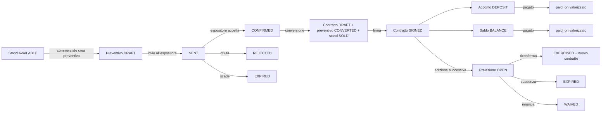
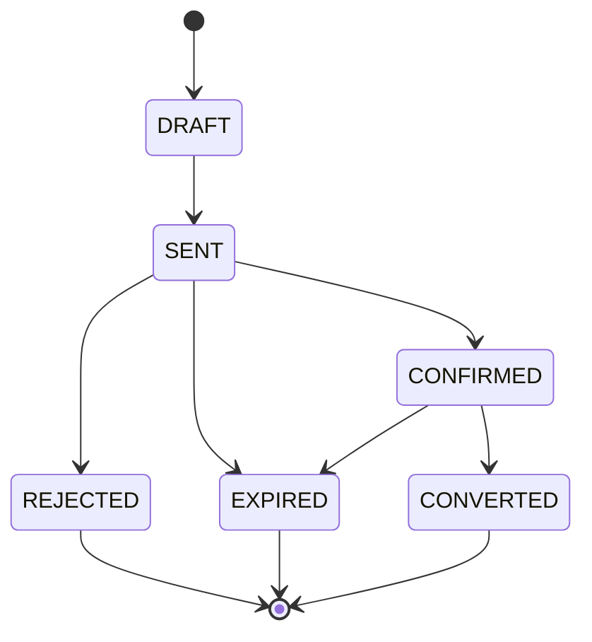
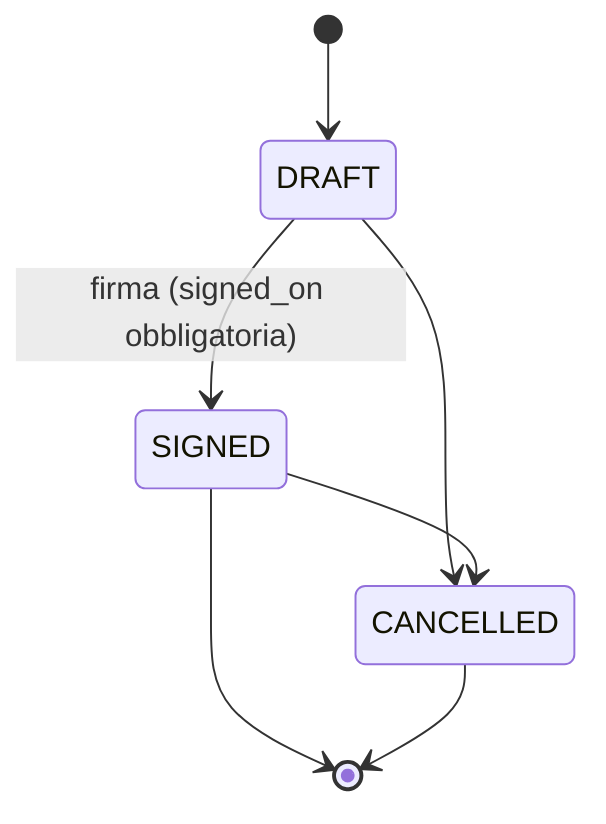
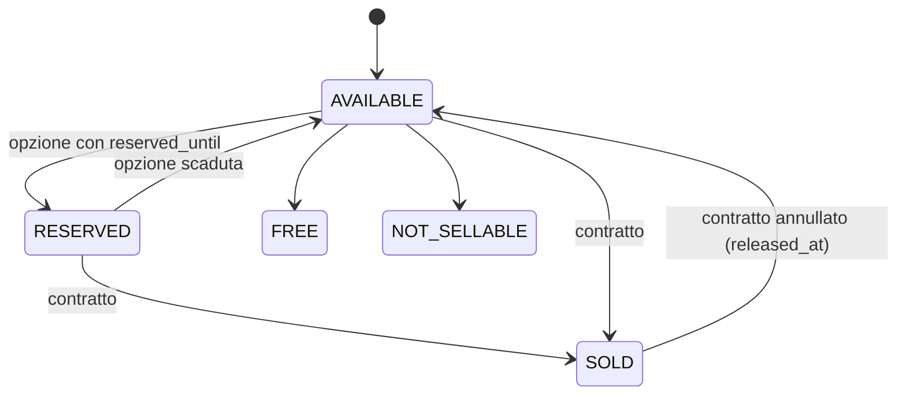
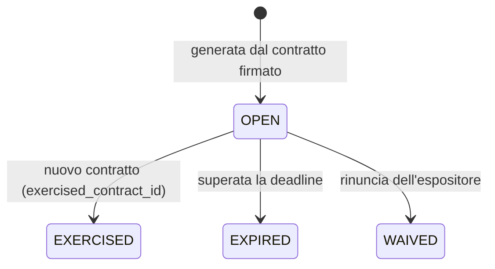

# Processo commerciale ARCADE: preventivo → contratto → acconto → saldo → prelazione

> BAD-02-01 (#53). Stati e vincoli presi da `database/migrations/V1__core_schema.sql` (ramo `BID`), così Power Apps, flussi e DB usano gli stessi nomi.
> Aggiornato al 16/11/2026. Regole e responsabili: vedi la sezione 4 (BAD-02-02, #54, decisione B-51).

## 1. Il processo in un colpo d'occhio

## 2. Stati per entità

### Preventivo (`core.quote.status`)

### Contratto (`core.contract.status`)

### Stand nell'edizione (`core.stand_edition.commercial_status`)

### Pagamento (`core.payment`)
- `kind`: `DEPOSIT` (acconto), `BALANCE` (saldo), `REFUND` (rimborso).
- Aperto finché `paid_on` e `paid_amount` sono vuoti; pagato quando sono valorizzati entrambi.
- `due_amount_basis`: `RULE_DERIVED` (calcolato dalla regola) o `CONTRACT_SCHEDULE` (scritto nel contratto).

### Prelazione (`core.preemption.status`)

## 3. Passaggi: chi fa cosa e cosa cambia nel DB

| # | Passaggio | Chi | Cosa cambia nel DB | Stand | Pagamenti |
|---|---|---|---|---|---|
| 1 | Nuovo preventivo | Commerciale (app back-office) | `quote` DRAFT + `quote_line`, numero `PV<anno>-<nnnn>` (B-37) | Resta AVAILABLE o diventa RESERVED con `reserved_until` | — |
| 2 | Invio | Commerciale | `quote.status` = SENT | Invariato | — |
| 3 | Accettazione / rifiuto / scadenza | Commerciale, su risposta dell'espositore | CONFIRMED / REJECTED / EXPIRED | Se REJECTED o EXPIRED torna AVAILABLE | — |
| 4 | Conversione | Commerciale: **un solo `Patch`** del preventivo a CONVERTED (B-51) | Il **trigger** su `core.quote` crea nella stessa transazione `contract` DRAFT (numero `C<anno>-<nnnn>` generato dal DB, `quote_id`), `contract_stand`, `contract_line`, `payment` DEPOSIT e BALANCE. Se fallisce non resta nulla e l'app riceve l'errore; poi l'app legge il contratto per `quote_id` | SOLD | Acconto 30% e saldo 70% (provvisorio, A-18) |
| 5 | Firma | Commerciale | `contract.status` = SIGNED + `signed_on` | SOLD | Invariati. Notifica all'amministrazione (flusso BAD-05-06) |
| 6 | Promemoria | Flusso BAD-05-03, ogni giorno alle 7:00 | Nessuna scrittura (legge `flow.v_payment_due`) | — | Email al commerciale per acconti e saldi in scadenza o scaduti |
| 7 | Incasso | Amministrazione | `payment.paid_on` + `paid_amount` | — | Pagato |
| 8 | Annullamento | Direzione / commerciale | `contract.status` = CANCELLED, `contract_stand.released_at` | Torna AVAILABLE | Eventuale REFUND |
| 9 | Prelazione | BID (generazione) → commerciale | `preemption` OPEN per l'edizione successiva, poi EXERCISED / EXPIRED / WAIVED | Bloccato per l'espositore fino alla deadline | Nuovo contratto se EXERCISED |

## 4. Regole e chi le garantisce (BAD-02-02, #54, proposta)

### Già garantite dal database (V1)
| Regola | Vincolo |
|---|---|
| Uno stand non si vende due volte nella stessa edizione | `ux_contract_stand_active` (indice unico su `stand_edition_id` con `released_at IS NULL`) |
| Un preventivo genera al massimo un contratto | `contract.quote_id UNIQUE` |
| Un contratto firmato ha la data di firma | `CHECK (status <> 'SIGNED' OR signed_on IS NOT NULL)` |
| Netto = listino × (1 − sconto) | `CHECK` su `contract` (tolleranza 0,01) |
| Importo riga = quantità × prezzo | `CHECK` su `quote_line` e `contract_line` |
| Righe SPACE/SURCHARGE legate a uno stand del contratto | `CHECK` + FK composita su `contract_line` |
| Contratto e stand della stessa edizione | FK composite `(…, edition_id)` |
| Un solo acconto e un solo saldo per contratto | `ux_payment_one_deposit_balance` |
| Data e importo pagato sempre insieme | `CHECK ((paid_on IS NULL) = (paid_amount IS NULL))` |
| Una sola prelazione viva per stand ed edizione | `ux_preemption_live_per_stand` |
| Prelazione EXERCISED solo con il nuovo contratto collegato | `CHECK` su `preemption` |
| `reserved_until` solo per stand RESERVED | `CHECK` su `stand_edition` |

### NON garantite dal database (scoperte)
| Regola | Rischio | Proposta |
|---|---|---|
| **Conversione tutta o niente** (contratto, stand, righe, pagamenti, preventivo CONVERTED) | Più `Patch` non sono una transazione: un errore a metà lascia un contratto incompleto | **Deciso (B-51, 16/11)**: trigger nel DB su `core.quote` (Fabrizio). L'app fa un solo `Patch` a CONVERTED; niente `Patch` in sequenza, niente attesa dell'API del BID |
| Ordine degli stati (es. CONVERTED solo da CONFIRMED, niente ritorno a DRAFT dopo SIGNED) | Nessun trigger nel DB | Power Apps: pulsanti attivi solo nello stato giusto |
| Stand SOLD quando c'è un `contract_stand` attivo | Disallineamento tra `stand_edition` e `contract_stand` | Nella conversione (API/funzione). In Power Apps: aggiornare entrambi nello stesso passaggio |
| Acconto + saldo = netto del contratto | I pagamenti possono non tornare con il contratto | Calcolo in Power Apps alla conversione (o nella funzione) |
| Pagato ≤ dovuto | Nessun `CHECK` sul totale (l'API prevede `PAYMENT_EXCEEDS_CONTRACT`) | Validazione in Power Apps sulla maschera incassi |
| Preventivo solo su stand AVAILABLE (o RESERVED per lo stesso espositore) | Si può preventivare uno stand venduto, l'errore arriva solo alla conversione | Filtro in Power Apps sulla scelta stand |

Decisione registrata in `docs/brain/contesto-BAD.md` come **B-51** (chiude A-08): conversione nel DB con trigger, le altre regole scoperte a Power Apps.
